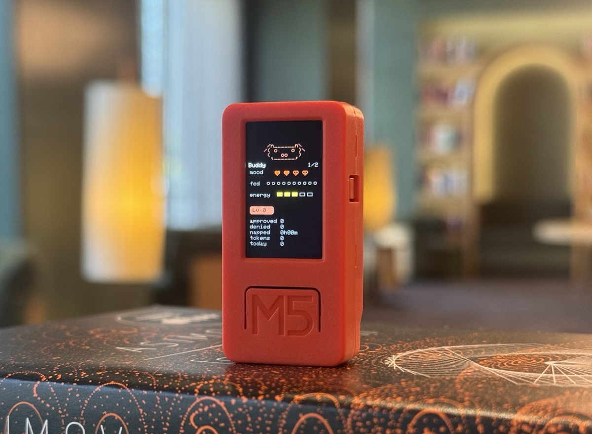

# buddy-ollama

A fork of [claude-desktop-buddy](https://github.com/anthropics/claude-desktop-buddy)
retargeted for **local Ollama** instead of the Claude desktop app.

The M5StickC Plus pet now talks to an Ollama HTTP proxy running on your
PC, over USB serial (no BLE pairing needed). Everything else — the ASCII
species, the seven animation states, the GIF character pipeline — is kept
intact so existing characters and stats keep working.

The companion bridge is a single-file Rust binary that ships a built-in
chat UI, a serial forwarder, and a small HTTP proxy in front of Ollama.

<p align="center">
  
</p>

## Hardware

The firmware targets the **M5StickC Plus** (ESP32-PICO-D4) with the Arduino
framework. It depends on the M5StickCPlus library for its display, IMU, and
button drivers.

- **Display**: 135×240 ST7789V2, driven via `TFT_eSprite` off-screen buffer
- **IMU**: MPU6886 (shake → dizzy, face-down → nap)
- **Buttons**: A (front), B (right), power (left)
- **Red LED**: GPIO 10, used as an "attention" pulse

Porting to another ESP32 board is a driver swap — the state machine and
ASCII renderer are board-agnostic.

## Flashing

Install
[PlatformIO Core](https://docs.platformio.org/en/latest/core/installation/),
then:

```bash
pio run -e m5stickc-plus -t upload

Pairing with Ollama
No Bluetooth pairing. The device talks to the bridge over USB serial.

Plug the M5StickC Plus into your PC with a data-capable USB-C cable.

Find the COM port
python -c "import serial.tools.list_ports; [print(p.device, '-', p.description) for p in serial.tools.list_ports.comports()]"

[other project]
.\buddy-bridge.exe --serial COM6
he bridge auto-opens http://127.0.0.1:11500/ in your browser — that's
the chat UI.

The bridge pushes status JSON to the stick every 500ms. The stick shows a
small connection dot in the top-right corner so you can tell at a glance
whether it's receiving data.

Requirements on the PC
Ollama running on localhost:11434

A pulled model (e.g. ollama pull qwen3:8b)
The buddy-bridge.exe binary (compile it yourself, see below)
Building the bridge
bash
cd bridge
cargo build --release
# → target/release/buddy-bridge.exe
Windows only for now. The bridge is plain Rust + tokio + axum; a Linux or
macOS build should work with minor tweaks (serial port path, opening the
browser).

Controls
Normal	Pet	Info	Approval
A (front)	next screen	next screen	next screen	approve
B (right)	scroll transcript	next page	next page	deny
Hold A	menu	menu	menu	menu
Power (left, short)	toggle screen off			
Power (left, ~6s)	hard power off			
Shake	dizzy			—
Face-down	nap (energy refills)			
The screen auto-powers-off after 30s of no interaction. Any button press
wakes it. When a request is streaming, the pet borrows the attention
state for the first 1.8s to show a "thinking" pose and a
- Thinking... label, then switches to busy.

ASCII pets
Eighteen pets, each with seven animations (sleep, idle, busy, attention,
celebrate, dizzy, heart). Menu → "next pet" cycles them with a counter.
Choice persists to NVS.

The default species for this fork is CHONK, a pig with droopy round
ears, a large snout, and four visible legs. Its attention animation is a
"thinking" pose: blink, look up, scratch, with a ? and three dots
floating above its head.

GIF pets
If you want a custom GIF character instead of an ASCII buddy, drag a
character pack folder onto the drop target in the chat UI. The bridge
streams it to the stick over serial and the firmware switches to GIF mode
live. Settings → delete char reverts to ASCII mode.

A character pack is a folder with manifest.json and 96px-wide GIFs:

json
{
  "name": "bufo",
  "colors": {
    "body": "#6B8E23",
    "bg": "#000000",
    "text": "#FFFFFF",
    "textDim": "#808080",
    "ink": "#000000"
  },
  "states": {
    "sleep": "sleep.gif",
    "idle": ["idle_0.gif", "idle_1.gif", "idle_2.gif"],
    "busy": "busy.gif",
    "attention": "attention.gif",
    "celebrate": "celebrate.gif",
    "dizzy": "dizzy.gif",
    "heart": "heart.gif"
  }
}
State values can be a single filename or an array. Arrays rotate: each
loop-end advances to the next GIF, useful for an idle activity carousel so
the home screen doesn't loop one clip forever.

GIFs are 96px wide; height up to ~140px stays on a 135×240 portrait screen.
Crop tight to the character — transparent margins waste screen and shrink
the sprite. tools/prep_character.py handles the resize.

The whole folder must fit under 1.8MB —
gifsicle --lossy=80 -O3 --colors 64 typically cuts 40–60%.

See characters/bufo/ for a working example.

To skip the serial round-trip while iterating on a character,
tools/flash_character.py characters/bufo stages it into data/ and runs
pio run -t uploadfs directly over USB.

The seven states
State	Trigger	Feel
sleep	bridge not connected	eyes closed, slow breathing
idle	connected, nothing urgent	blinking, looking around
busy	Ollama request actively running	sweating, working
attention	first 1.8s of a request	thinking, ? overhead
celebrate	level up (every 50K tokens)	confetti, bouncing
dizzy	you shook the stick	spiral eyes, wobbling
heart	approved in under 5s	floating hearts
The bridge also exposes manual emotion triggers via
GET /emote?name=heart (or the emoji buttons in the chat UI), which fires
a one-shot triggerOneShot() on the firmware regardless of the LLM state.

The bridge
Single-file Rust binary at bridge/:

text
bridge/
├── Cargo.toml
└── src/
    ├── main.rs         — HTTP server + serial forwarder + DuckDuckGo search
    └── chat.html       — embedded chat UI (include_str!)
Responsibilities:

HTTP proxy on 127.0.0.1:11500, forwards /v1/chat/completions and
/v1/models to Ollama on localhost:11434, with CORS enabled

Serial forwarder on the configured COM port, pushes status JSON every
500ms, drains emote commands immediately

Search — when the chat UI sends use_search: true, the bridge queries
DuckDuckGo HTML, extracts the top 5 results, and injects them into the
system prompt before forwarding to Ollama

Programming modes — chat UI can send mode: "code" | "debug" | "explain",
which selects a different system prompt on the bridge side

Chat UI — drag-and-drop files, screenshot capture, clipboard paste,
conversation history in localStorage, code highlighting via
highlight.js

Bridge CLI
Flag	Default	Meaning
--serial	COM6	Serial port of the stick
--baud	115200	Serial baud
--backend	http://localhost:11434	Ollama base URL
--listen	127.0.0.1:11500	HTTP listen address
Project layout
text
src/
  main.cpp       — loop, state machine, UI screens, emote handler
  buddy.cpp      — ASCII species dispatch + render helpers
  buddies/       — one file per species, seven anim functions each
  ble_bridge.cpp — Nordic UART service (kept, currently unused)
  character.cpp  — GIF decode + render
  data.h         — wire protocol, JSON parse, emote field
  xfer.h         — folder push receiver
  stats.h        — NVS-backed stats, settings, owner, species choice
bridge/
  Cargo.toml
  src/main.rs
  src/chat.html
characters/      — example GIF character packs
tools/
  prep_character.py
  flash_character.py
  deepseek_buddy_bridge.py   — legacy Python bridge (superseded by Rust)
Differences from upstream
Transport: still USB serial by default; BLE code is present but the
bridge pushes over serial. BLE advertising name changed to
DeepSeek-Buddy.

 
